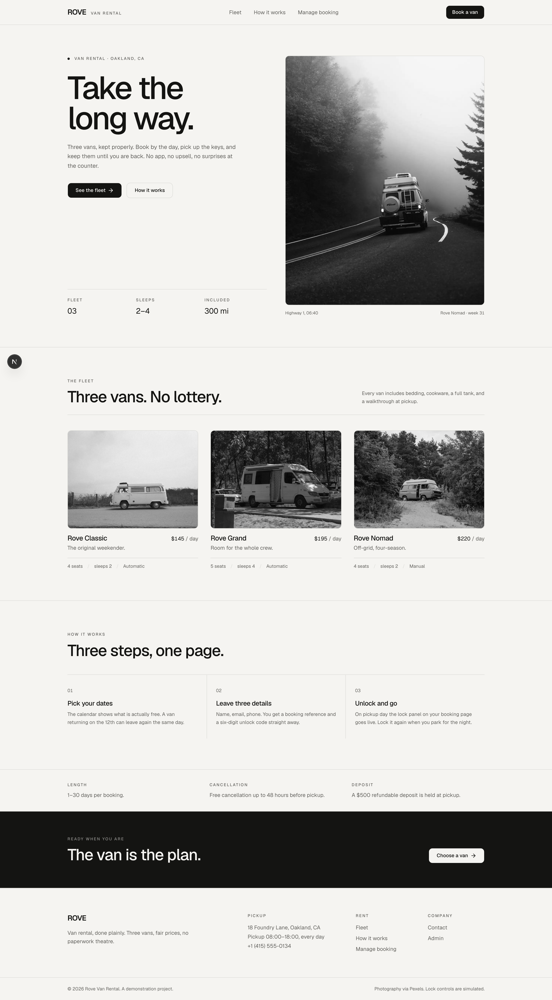

# Rove — van rental booking system

> **Interview task.** This project was built as a take-home technical assignment
> for a job interview, not as a commercial product. The brief is reproduced
> verbatim in [`context/00-product-brief.md`](./context/00-product-brief.md),
> and the scope cuts are documented in
> [`context/10-known-limits.md`](./context/10-known-limits.md).

A small, complete booking product: three vans, live availability, an admin
dashboard, and a simulated van lock. The emphasis is on correctness of the
booking rules, a clean UI, and documentation that explains every decision.

| | |
|---|---|
| **Live app** | https://rove-van-rental.vercel.app |
| **Admin** | `/admin/login` — demo password `admin@123` |
| **Stack** | Next.js 16 · React 19 · TypeScript · Tailwind 4 · shadcn/ui · Prisma 7 · Postgres (Neon) |
| **Docs** | [`context/`](./context) — spec, architecture, ADRs, milestones, runbook |



## What it does

**Customer**

- Browse three vans with photos, specs, features, and daily prices.
- Pick a date range in a calendar that greys out nights already booked.
- Enter name, email, and phone; see the price breakdown before confirming.
- Receive a booking reference (`RV-XXXXXX`) and a six-digit unlock code.
- Reopen the booking from `/manage` at any time.
- Lock and unlock the van from the booking page — only during the rental
  window, every toggle recorded.

**Admin**

- Password-protected dashboard with confirmed / active / upcoming counts and
  booked revenue.
- Searchable reservation table, filterable by status.
- Reservation detail with customer contact, price breakdown, lock state, and
  the full lock event log.
- Cancel a reservation (dates are released immediately) or override the lock.

## The rules that matter

- Dates are **half-open**: a reservation occupies `[pickup, return)`. A van
  returned on the 12th can be picked up on the 12th.
- A van can never hold two confirmed reservations on the same night. This is
  enforced three times over: in the UI, in a serializable transaction, and by
  a Postgres `EXCLUDE USING gist` constraint. The database is the final word.
- Price is `nights × daily rate + one-off cleaning fee`, snapshotted onto the
  reservation so historical totals never drift.
- The lock only responds while `pickup ≤ today ≤ return`; outside that window
  the API refuses and the button is disabled with a reason.

## Run it locally

```bash
pnpm install
cp .env.example .env        # add DATABASE_URL, DIRECT_URL, ADMIN_PASSWORD, SESSION_SECRET
pnpm db:migrate             # apply migrations
pnpm db:seed                # 3 vans + 2 demo reservations
pnpm dev                    # http://localhost:3000
```

`pnpm build` runs `prisma generate` first, so a fresh clone builds on Vercel
without a manual step.

## Scripts

| Script | Purpose |
|---|---|
| `pnpm dev` | Development server |
| `pnpm build` | Prisma generate + production build |
| `pnpm typecheck` | `tsc --noEmit` |
| `pnpm lint` | ESLint (Next config) |
| `pnpm test` | 22 unit tests (Vitest) |
| `pnpm test:e2e` | Playwright: booking, overlap, lookup, admin, lock, mobile, axe accessibility |
| `pnpm db:migrate` | `prisma migrate deploy` |
| `pnpm db:seed` | Idempotent seed |
| `pnpm db:studio` | Prisma Studio |

## Project layout

```
src/
  app/
    page.tsx                     marketing home + fleet
    vans/[slug]/page.tsx         van detail + booking form
    reservations/[reference]/    confirmation, unlock code, lock control
    manage/                      reference lookup
    admin/login/                 password sign-in
    admin/(dashboard)/           protected dashboard + detail
    actions/                     server actions (booking, lock, admin)
  components/                    UI (shadcn primitives in ui/)
  lib/                           dates, pricing, availability, validation, db, auth
  store/                         Redux Toolkit booking draft
  proxy.ts                       Next 16 proxy (formerly middleware)
prisma/                          schema, hand-edited SQL constraints, seed
context/                         product spec, architecture, ADRs, runbook
tests/unit/                      Vitest
e2e/                             Playwright
```

## Notes

- Photography is from Pexels (free licence); images are committed locally so
  the site never depends on a third-party CDN.
- The lock is simulated. There is no vehicle integration, and the UI says so.
- Payments, email delivery, and driver verification are deliberately out of
  scope — see [`context/10-known-limits.md`](./context/10-known-limits.md).
