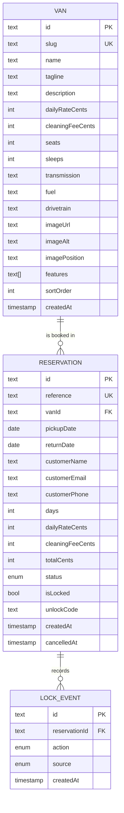

# 03 · Data model

## Diagram



## Enums

| Enum | Values |
|---|---|
| `ReservationStatus` | `CONFIRMED`, `CANCELLED` |
| `LockAction` | `LOCK`, `UNLOCK` |
| `LockSource` | `CUSTOMER`, `ADMIN` |

## Invariants

1. `returnDate > pickupDate` — enforced by `Reservation_date_order` CHECK and by
   Zod.
2. No two `CONFIRMED` reservations for the same van may overlap — enforced by
   `Reservation_no_overlap` exclusion constraint.
3. `days = returnDate - pickupDate` (calendar days).
4. `totalCents = days × dailyRateCents + cleaningFeeCents`, computed server-side.
5. Money is always an integer number of cents.
6. `reference` is unique and matches `^RV-[A-Z0-9]{6}$`.
7. `unlockCode` is six digits, generated per reservation, shown only to whoever
   holds the reference.
8. A cancelled reservation can never be locked, cancelled again, or rebooked;
   cancellation is terminal for this product.
9. Every lock change writes exactly one `LockEvent` in the same transaction.

## The exclusion constraint

Prisma cannot express exclusion constraints, so it is added by hand to the
initial migration:

```sql
CREATE EXTENSION IF NOT EXISTS btree_gist;

ALTER TABLE "Reservation"
  ADD CONSTRAINT "Reservation_no_overlap"
  EXCLUDE USING gist (
    "vanId" WITH =,
    daterange("pickupDate", "returnDate", '[)') WITH &&
  )
  WHERE ("status" = 'CONFIRMED');
```

- `btree_gist` lets a scalar column (`vanId`) participate in a GiST exclusion
  constraint.
- `daterange(..., '[)')` makes the range half-open: return day is free.
- The partial predicate means **cancelled** rows do not block dates, so
  cancelling releases availability immediately.
- Violations surface as Postgres error `23P01`; the action maps that to a
  user-facing conflict message.

Manual verification:

```sql
-- should fail with "conflicting key value violates exclusion constraint"
INSERT INTO "Reservation" (...) VALUES (same van, overlapping dates, CONFIRMED);
```

## Indexes

| Index | Serves |
|---|---|
| `Van_slug_key` | `/vans/[slug]` lookup |
| `Van_sortOrder_idx` | fleet ordering |
| `Reservation_reference_key` | manage lookup, confirmation page |
| `Reservation_vanId_pickupDate_returnDate_idx` | availability query |
| `Reservation_customerEmail_idx` | admin search, future email features |
| `Reservation_status_pickupDate_idx` | admin tabs, active/upcoming counts |
| `LockEvent_reservationId_createdAt_idx` | activity timeline |

## Why snapshot the price

`dailyRateCents`, `cleaningFeeCents`, `days`, and `totalCents` are copied onto
the reservation at creation. If a van's rate changes next month, the existing
reservation still shows what the customer agreed to. Joining to `Van` for price
would silently rewrite history.

## Date handling

- Postgres column type: `date` (no time, no zone).
- Prisma returns a JS `Date` at `00:00:00Z`; `toIsoDate()` slices the ISO string
  to get `YYYY-MM-DD`.
- Application code never calls `toISOString()` on a locally constructed date —
  that shifts the calendar date east of UTC. All date math goes through
  `src/lib/dates.ts`, which is unit-tested for exactly this bug.
- `createdAt`, `cancelledAt`, and `LockEvent.createdAt` are timestamps, shown
  in UTC and labelled as such.

## Seed data

`prisma/seed.ts` is idempotent (upsert by slug / reference):

- 3 vans: Classic ($145/day, $45 cleaning), Grand ($195, $60), Nomad ($220, $75).
- 2 demo reservations relative to today (`RV-DEMO01`, `RV-DEMO02`) so the admin
  dashboard and the availability calendar are not empty on a fresh install.
